<!-- Generated by scripts/readme/build.mjs in atiq-sm/atiq-sm.github.io, from the site's own content and illustrations. Edit there and regenerate. -->

<a href="https://atiq-sm.github.io"></a>

<a href="https://atiq-sm.github.io/work/">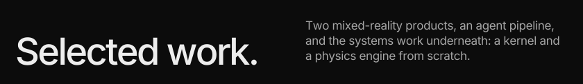</a>

<a href="https://atiq-sm.github.io/work/mr-pocus/">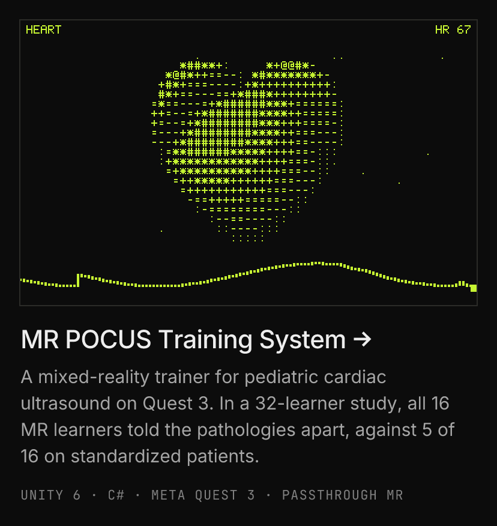</a>
<a href="https://atiq-sm.github.io/work/cardalive/">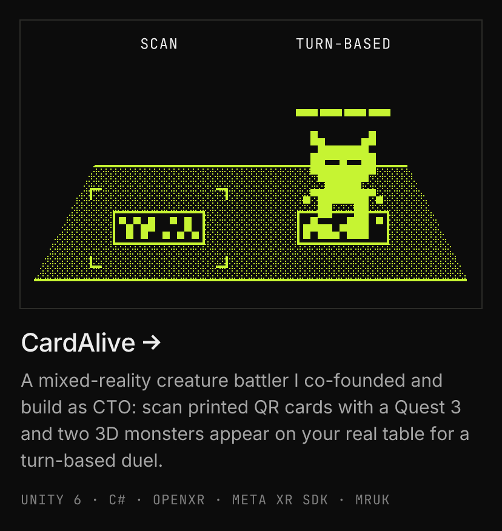</a>

<b>The MR POCUS study:</b> all 16 mixed-reality learners told the pathologies apart, against 5 of 16 on standardized patients

 

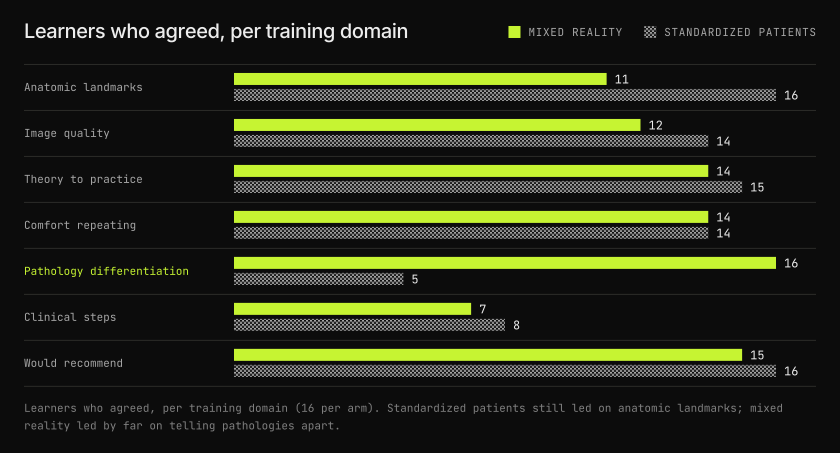

A controlled study at the BBCH Pediatric Ultrasound Conference: 32 learners, half trained in mixed reality and half on standardized patients.

- **16/16 vs 5/16** · Learners who could tell the pathologies apart, MR vs standardized patients (p = 0.003)
- **100% vs 40%** · Said the training helped them tell normal from abnormal
- **95%** · Would use the MR trainer at future courses
- **80%** · Prefer a 50/50 mix of MR and standardized patients
- **15/16 + 4/4** · Learners and faculty who recommend it
- **1 of 20** · Reported any VR symptoms

<a href="https://atiq-sm.github.io/work/mr-pocus/">Read the case study, with footage from the headset →</a>

<b>How CardAlive works:</b> from a printed card to a monster standing on your real table, in five steps

 

1. **Camera.** On Quest, frames come from the Passthrough Camera API, tagged with the head pose at the moment of capture; on desktop, from a webcam.
2. **Decode.** ZXing.NET finds every QR code in a frame, so both cards are read at once, a few times a second.
3. **Place.** A ray from each code is cast against the depth mesh MRUK builds of the room, so the creature stands on the real table.
4. **Spawn.** The code picks the creature, which appears with its health bar, facing its opponent.
5. **Battle.** A state machine runs the duel: scanning, ready, then the player and enemy turns until a creature falls.

<a href="https://atiq-sm.github.io/work/cardalive/">Watch it play, recorded through a Quest 3 →</a>

<a href="https://github.com/atiq-sm/NPC-AI">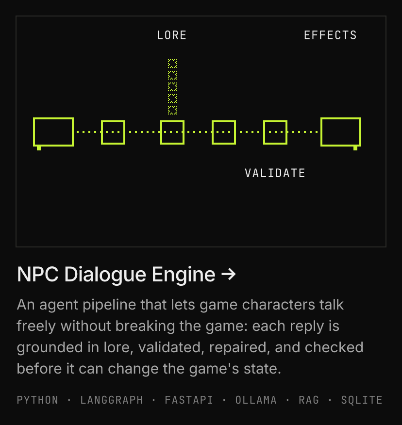</a>
<a href="https://github.com/atiq-sm/baremetal-snake">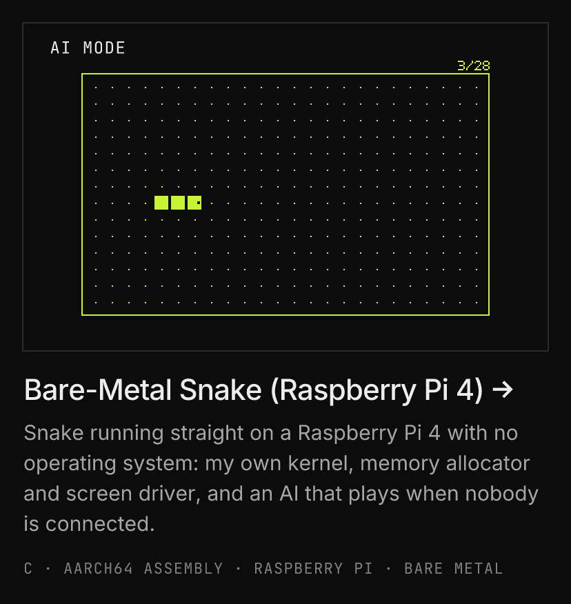</a>

<a href="https://github.com/atiq-sm/cosmic-knockout">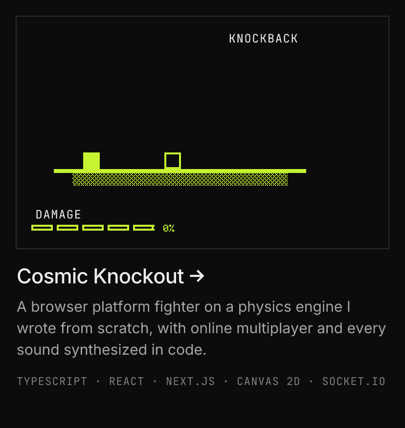</a>
<a href="https://atiq-sm.github.io/work/">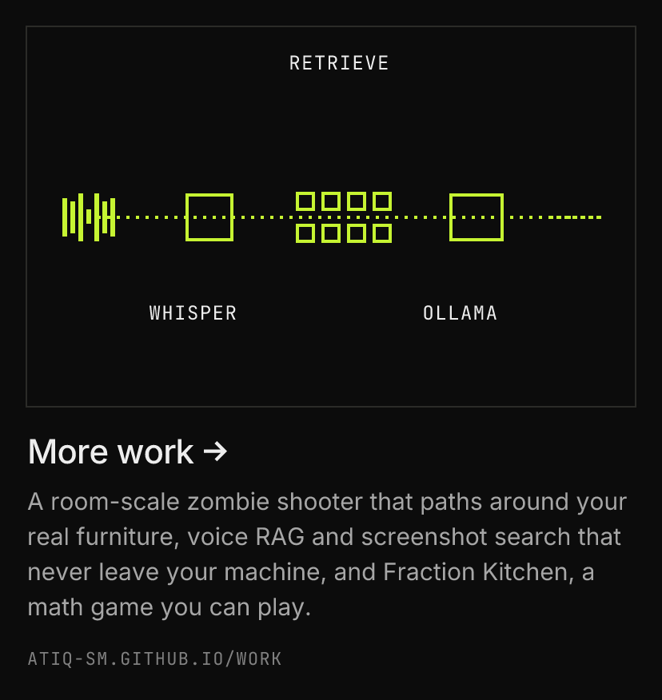</a>

<b>Experience:</b> Co-founder & CTO at CardAlive; before that, Roux Institute × MaineHealth, Aosenuma and Capgemini

 

**Co-founder & CTO** · CardAlive  
May 2026 — Present

- Building a mixed-reality tabletop creature battler for Meta Quest 3 in Unity 6 and C#: scan printed QR cards and two 3D monsters appear on your real table for a turn-based duel.
- Built the card-to-fight pipeline: passthrough camera frames, multi-QR decoding with ZXing.NET, and placement by raycasting against the MRUK depth mesh so creatures stand on the real table.

**XR Developer, Research** · Northeastern University (Roux Institute) & MaineHealth  
Jan. 2026 — Apr. 2026 · Portland, ME

- Lead developer of a mixed-reality pediatric cardiac ultrasound trainer for Meta Quest 3, in Unity and C#. In a controlled study (n = 32) at the BBCH Pediatric Ultrasound Conference, all 16 MR learners told the pathologies apart, against 5 of 16 trained on standardized patients.
- Designed probe-pose matching with position and angle tolerances and entry and exit dwell gates, so clips start reliably and hold steady while a learner adjusts the probe.

**AI Developer Intern** · Aosenuma LLC  
Sep. 2025 — Dec. 2025 · Houston, TX

- Built a full-stack healthcare platform (Next.js, React, FastAPI, Supabase Postgres) with AI semantic search over pgvector embeddings.
- Kept each workspace's data separate with five-role access control and Postgres row-level security, plus audit logging for compliance.

**Senior Analyst — Data Analytics & Engineering** · Capgemini  
June 2022 — Dec. 2023 · Bangalore, India

- Built ETL pipelines for 2M+ records a day from distributed microservices, with data-quality monitoring and lineage tracking.
- Built the monitoring around them: real-time dashboards, alerting, and CI/CD test automation.

**M.S. Computer Science — GPA 4.0 / 4.0** · Northeastern University  
Jan. 2024 — May 2026 · Portland, ME

- Coursework: Machine Learning, Computer Vision, Mixed Reality, Algorithms, Computer Networks.

**B.Tech Computer Science (Cyber Security) — GPA 8.8 / 10** · KL Deemed to be University  
Aug. 2018 — May 2022 · Hyderabad, India

- Coursework: Cryptography, Digital Forensics, Network Security, Blockchain, Data Science.

<a href="https://atiq-sm.github.io/about/#experience">The full history →</a>

<a href="https://atiq-sm.github.io/work/">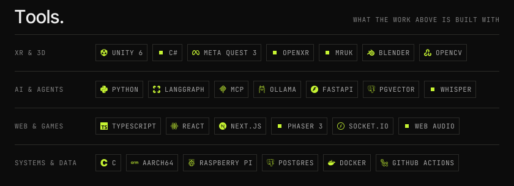</a>

<a href="mailto:mohammed.ati@northeastern.edu"></a>

Drawn with the same scene kit and dither as <a href="https://atiq-sm.github.io">atiq-sm.github.io</a>, and rendered to GIF by <a href="https://github.com/atiq-sm/atiq-sm.github.io/tree/main/scripts/readme">scripts/readme</a>.
